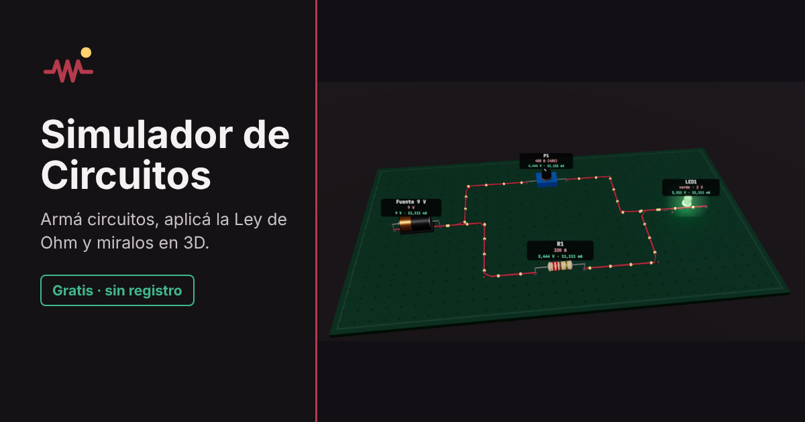

# Simulador de Circuitos — Ley de Ohm

Simulador educativo de circuitos de corriente continua, hecho como proyecto escolar.
Permite armar circuitos, aplicar la Ley de Ohm, medir con amperímetro y voltímetro y ver el circuito en 3D.

**Abrir el simulador:** https://jeremias0211.github.io/Simulador-De-Circuitos/

## Qué se puede hacer

- Armar circuitos con resistencias, potenciómetros, lámparas, LED, interruptores, fuentes, amperímetros y voltímetros.
- Simular en vivo: tensión, corriente y potencia de cada componente, resistencia equivalente, cortocircuitos, circuitos abiertos y componentes quemados.
- Ver **cómo se calculó** cada valor, paso a paso.
- Ver el circuito en **3D**, con la corriente moviéndose por los cables.
- Estudiar la teoría en la sección **Aprendé** y practicar con **Desafíos**.
- Imprimir un **reporte para el docente** con los desafíos resueltos.
- Guardar, abrir y compartir circuitos, y exportarlos como imagen.

## Publicar en GitHub Pages

1. Subí todos los archivos de esta carpeta a la rama `main` del repositorio (incluidas las carpetas `lib/` y `fonts/`).
2. En GitHub, entrá a **Settings → Pages**.
3. En **Build and deployment → Source** elegí **Deploy from a branch**, rama **main** y carpeta **/ (root)**. Guardá.
4. En uno o dos minutos el sitio queda en `https://jeremias0211.github.io/Simulador-De-Circuitos/`.

Para probarlo en la computadora, alcanza con abrir `index.html` con doble clic.

## Datos del proyecto

Los autores, la escuela, la materia y el curso que aparecen en **Acerca de** se editan al principio del archivo `content.js` (objeto `SITE_INFO`).

## Estructura

| Archivo | Para qué sirve |
| --- | --- |
| `index.html` | Página principal |
| `style.css` | Estilos |
| `script.js` | Editor, simulación eléctrica, desafíos |
| `view3d.js` | Vista 3D |
| `content.js` | Sección Aprendé, reporte, créditos, privacidad y licencias |
| `lib/three-bundle.min.js` | Motor 3D (Three.js) |
| `fonts/` | Tipografías incluidas (funcionan sin internet) |
| `simulador-circuitos.html` | Redirección a `index.html` (para links viejos) |

## Privacidad

El sitio no usa cookies, cuentas, publicidad ni estadísticas, y no se conecta a otros servidores.
El circuito y el progreso se guardan sólo en el navegador de cada usuario.

## Licencias de terceros

- [Three.js](https://threejs.org/) — Licencia MIT (`lib/LICENSE-three.txt`).
- [Inter](https://rsms.me/inter/) y [JetBrains Mono](https://www.jetbrains.com/lp/mono/) — SIL Open Font License 1.1 (`fonts/`).

> ⚠ Es una simulación educativa. Nunca experimentes con la electricidad de los enchufes (220 V).
